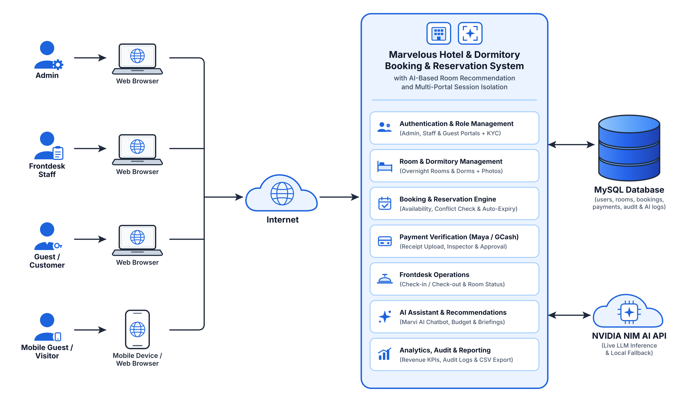
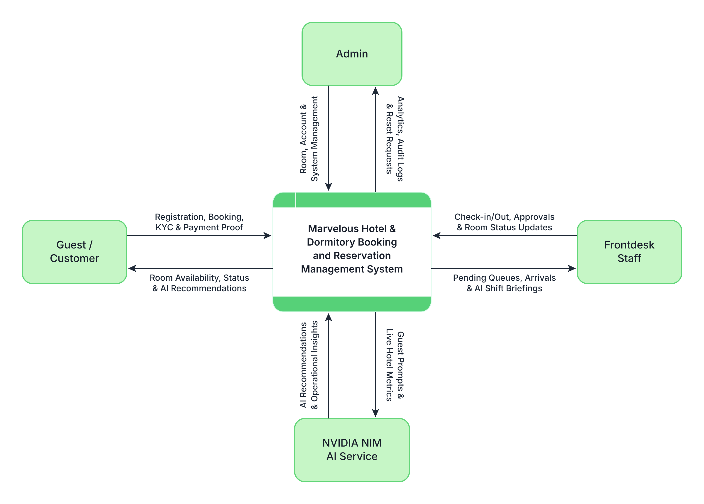
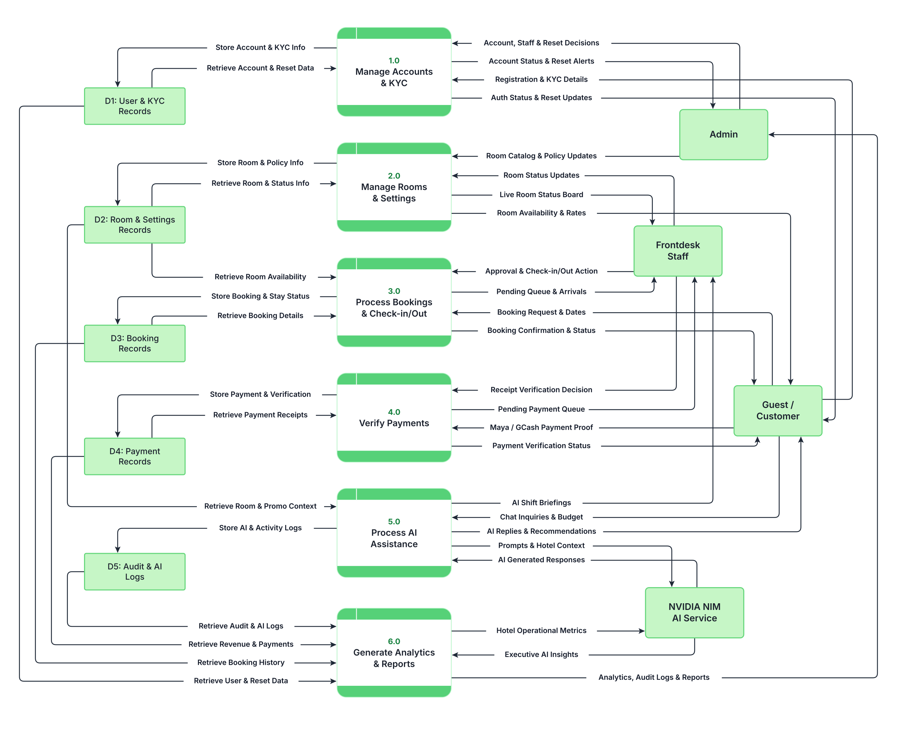
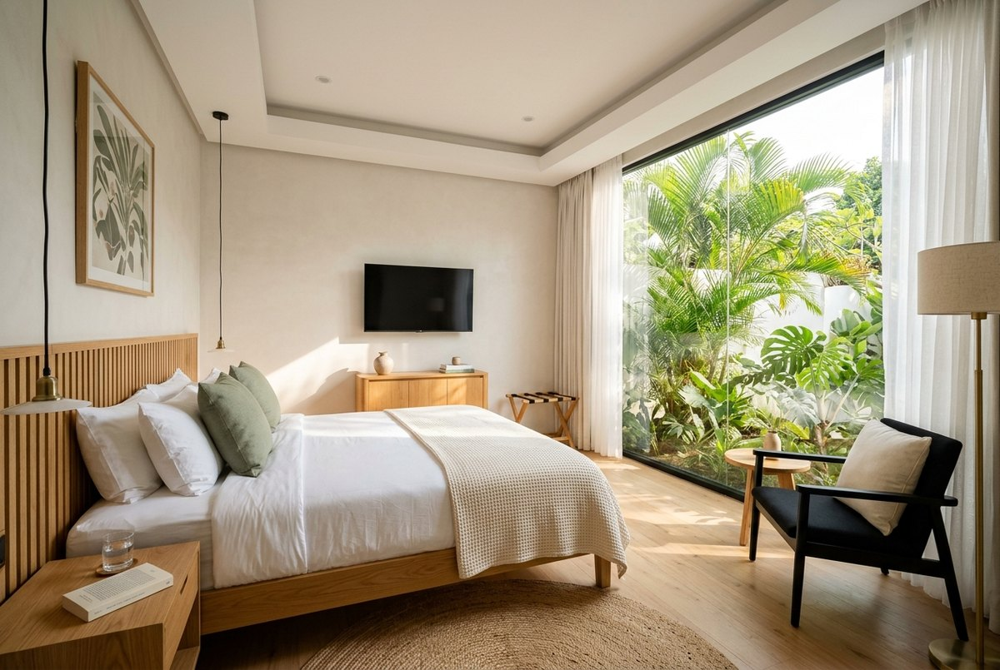
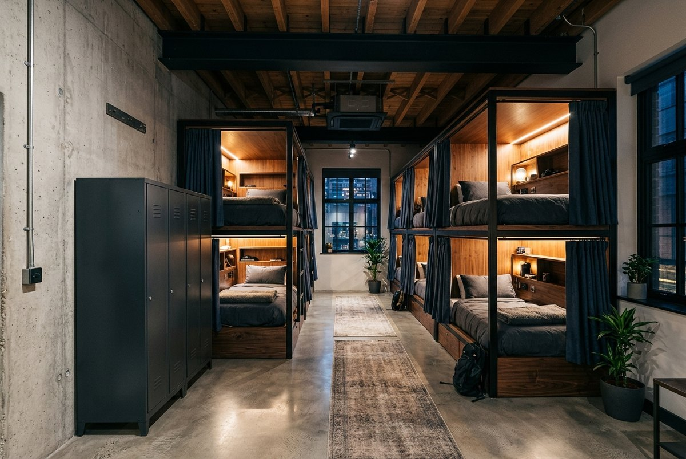
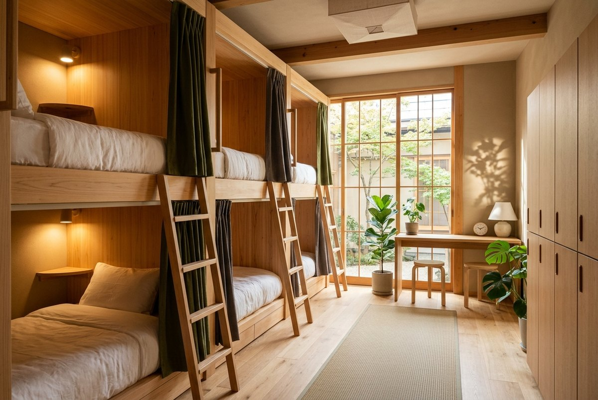

# 🏨 Marvelous Hotel and Dormitory Booking and Reservation Management System with AI-Based Room Recommendation

A comprehensive **3-Tier Hotel & Dormitory Web Application** structured cleanly into **`frontend/`** (**Tailwind CSS + Alpine.js 3**, HTML5, CSS3, ES6+ JavaScript), **`backend/`** (**Slim 4 PHP 8 REST API Framework**, PSR-4 Services/Controllers/Middleware, Real-Time NVIDIA NIM SSE AI), and **`database/`** (**MySQL / MariaDB SQL** via PDO with 20 versioned migrations), designed to run natively on **XAMPP**.

---

## 🎨 System Design Layouts & Architecture Diagrams

### 1. System Architecture
High-level multi-tier blueprint connecting **Admin**, **Frontdesk Staff**, **Guest / Customer**, and **Mobile Visitor** clients over the web into the 7 core system modules, **MySQL Database**, and **NVIDIA NIM AI API**.

<p align="center">
  
</p>

### 2. Level 0 Data Flow Diagram (Context Diagram)
Top-level context view illustrating bidirectional data flows between the **Marvelous Hotel & Dormitory Booking and Reservation Management System** and all four external entities (**Admin**, **Guest / Customer**, **Frontdesk Staff**, and **NVIDIA NIM AI Service**).

<p align="center">
  
</p>

### 3. Level 1 Data Flow Diagram
Detailed decomposition into **6 balanced processes (`1.0`–`6.0`)** and **5 database stores (`D1`–`D5`)** covering Accounts & KYC, Rooms & Settings, Bookings & Check-in/Out, Maya/GCash Payment Verification, Marvi AI Assistance, and Executive Analytics & Reporting.

<p align="center">
  
</p>

### 4. Accommodation Catalog Design Layout (3 Overnight Hotel Rooms + 3 Dormitory Rooms)
Every room in the 6-room catalog features a unique photorealistic interior image managed with automatic `?v=<filemtime>` cache-busting and Admin Hotel vs. Dormitory CRUD controls (`frontend/admin/rooms.php`).

#### 🌙 Hotel Rooms (Overnight / Pang-gabi)
| Room #101 — Standard Hotel Room | Room #201 — Deluxe Hotel Room | Room #301 — Executive Suite |
| :---: | :---: | :---: |
|  |  |  |
| **Overnight · Max 2 Pax** · ₱1,500/night | **Overnight · Max 2 Pax** · ₱2,500/night | **Overnight · Max 4 Pax** · ₱4,200/night |

#### 🛏️ Dormitory Rooms (Per Bed / Night)
| Room #D01 — Female Dormitory | Room #D02 — Male Dormitory | Room #D03 — Mixed Barkada Dormitory |
| :---: | :---: | :---: |
|  |  |  |
| **Dormitory · 6 Beds** · ₱450/bed | **Dormitory · 6 Beds** · ₱450/bed | **Dormitory · 8 Beds** · ₱400/bed |

---

## 🚀 How to Setup and Run on XAMPP

### 1. Place the Project in `htdocs`
Ensure the hotel project directory is located inside your XAMPP `htdocs` folder:
* **Linux:** `/opt/lampp/htdocs/hotel`
* **Windows:** `C:/xampp/htdocs/hotel`

### 2. Start Apache and MySQL
* **Linux (Terminal):**
  ```bash
  sudo /opt/lampp/lampp start
  ```
* **Windows:** Open the **XAMPP Control Panel** and click **Start** next to **Apache** and **MySQL**.

### 3. Import the Database
Navigate to `http://localhost/phpmyadmin/` in your browser or run the following terminal command:
```bash
/opt/lampp/bin/mysql -u root -e "CREATE DATABASE IF NOT EXISTS marvelous_hotel;"
/opt/lampp/bin/mysql -u root marvelous_hotel < database/marvelous_hotel.sql
```

Pagkatapos ng import (at sa bawat bagong release na may schema change), patakbuhin ang migration runner:
```bash
cd /opt/lampp/htdocs/hotel
php database/migrate.php           # ilapat ang mga pending migration
php database/migrate.php --status  # i-list ang applied/pending
```
Naka-track ang bawat migration sa `schema_migrations` table — isang beses lang ito binubuksan bawat file sa `database/migrations/`.

### 4. Set Up Secure Uploads Directory (Optional - for file serving)
```bash
mkdir -p /opt/lampp/htdocs/hotel/uploads/rooms /opt/lampp/htdocs/hotel/uploads/proofs /opt/lampp/htdocs/hotel/uploads/documents /opt/lampp/htdocs/hotel/uploads/avatars
chmod -R 755 /opt/lampp/htdocs/hotel/uploads
```

### 5. Enable Multi-Server VirtualHosts in XAMPP (Optional)
To host each portal on its dedicated port (`:8080`, `:8081`, `:8082`):
1. Open `/opt/lampp/etc/httpd.conf` and uncomment:
   ```apache
   Include etc/extra/httpd-vhosts.conf
   ```
2. Copy the configuration file for your OS:
   ```bash
   sudo cp /opt/lampp/htdocs/hotel/config/apache/vhosts-linux.conf /opt/lampp/etc/extra/httpd-vhosts.conf
   # Windows XAMPP: copy config/apache/vhosts-windows.conf to C:/xampp/apache/conf/extra/httpd-vhosts.conf
   ```
3. Restart Apache:
   ```bash
   sudo /opt/lampp/lampp restartapache
   ```

---

## 🌐 Multi-Server Architecture & How to Access Each Portal

Every module features its own dedicated URL, distinct access credentials, and isolated CSS/JS scripts. In addition to standard XAMPP paths, the system includes ready-to-run multi-port Apache configurations ([`vhosts-linux.conf`](file:///opt/lampp/htdocs/hotel/config/apache/vhosts-linux.conf) & [`vhosts-windows.conf`](file:///opt/lampp/htdocs/hotel/config/apache/vhosts-windows.conf)) to run each portal on dedicated servers/ports:

| Server / Portal | Multi-Port URL | Standard XAMPP URL | Access Level & Permissions |
|---|---|---|---|
| 👑 **Super Admin** | `http://localhost:8081/` | `http://localhost/hotel/admin/login.php` | **Full Master Authority:** View all users & staff, Master Password Reset, ban/activate, room inventory, payment approvals, settings. |
| 👨‍💼 **Staff Frontdesk** | `http://localhost:8082/` | `http://localhost/hotel/staff/login.php` | **Strict Operations Only:** Fast Check-in/out, live room status, guest inquiries. ❌ No account creation, no password resets. |
| 🌐👤 **Guest & Public Portal** | `http://localhost:8080/` | `http://localhost/hotel/` (Website) & `auth/login.php` | **Unified Guest Self-Service & Public Showcase:** Public website showcase, room catalog, self-registration, booking, KYC ID submission, QR payments (GCash & Maya), and Marvi AI Chatbot. |

### 🔒 Independent Session Isolation Engine (Zero Cross-Portal Collisions)
To completely prevent session conflicts and the "Auto Admin Only" bug when navigating between roles, each portal operates on an **isolated PHP session cookie namespace**:
* **Admin Server:** Cookie `MH_ADMIN_SESS`
* **Staff Server:** Cookie `MH_STAFF_SESS`
* **User / Public Server:** Cookie `MH_USER_SESS`

**Key Advantages:**
1. **Parallel Multi-Role Sessions:** You can stay logged into the Super Admin panel in Tab 1 while testing the User Booking flow in Tab 2 within the exact same browser window without session drops or auto-admin redirections.
2. **Autonomous Gatekeeping:** `redirectIfLoggedIn()` and `requireRole()` inspect only the session belonging to their active portal (`getActivePortal()`), preventing accidental unauthorized bounces across portals.
3. **Multi-Port & Standard Path Parity:** The engine auto-detects VirtualHost environment flags (`MH_PORTAL`), listening ports (`8080`, `8081`, `8082`), subdomains (`admin.hotel.local`, etc.), and script paths (`/admin/`, `/staff/`). It provides 100% session isolation whether running under Apache multi-port virtual hosts or classic standard `localhost/hotel` URLs.

---

### 👑 1. Admin Portal (Super Admin Server — Port 8081)
Designed for hotel owners and general managers. Holds master control over the entire system.

* **Multi-Port URL:** `http://localhost:8081/`
* **Standard Login URL:** [`http://localhost/hotel/admin/login.php`](http://localhost/hotel/admin/login.php)
* **Access Rule:** 🔒 **Walang direct link patungong dashboard.** Required mag-login muna bago ma-access ang system.
* **Login Email:** `admin@marveloushotel.com`
* **Password:** `password`
* **Key Features:**
  * **Master Password Reset:** Directly reset passwords for any User or Staff member with auto-generator tool (`admin/users.php`, `admin/staff.php`)
  * **Full Account Lifecycle:** Activate, suspend, ban, or create Staff accounts
  * Real-time search filters across data tables
  * Approval and verification of **GCash and PayMaya (Maya)** receipts
  * Full room and dormitory inventory management (Add, Edit, Delete)
  * AI interaction and security threat monitoring
  * **Room thumbnail image upload with secure validation**

---

### 👨‍💼 2. Staff Portal (Frontdesk Operations Server — Port 8082)
Tailored for frontdesk officers and receptionists to streamline day-to-day hotel operations.

* **Multi-Port URL:** `http://localhost:8082/`
* **Standard Login URL:** [`http://localhost/hotel/staff/login.php`](http://localhost/hotel/staff/login.php)
* **Access Rule:** 🔒 **Walang direct link patungong dashboard.** Required mag-login muna ang Frontdesk staff.
* **Login Email:** `staff@marveloushotel.com`
* **Password:** `password`
* **Account Provisioning:** Staff accounts are created **only by the Admin** via Admin Portal → Staff (`admin/staff.php`). Public self-registration (`auth/register-staff.php`) is permanently **closed** and redirects to this login page.
* **Strict Security Policy:** Staff members have **zero authority over accounts and credentials**. They cannot reset passwords, change user emails, modify room pricing, or alter system configurations.
* **Key Features:**
  * Fast Check-in and Check-out workflow
  * Live Room Status board (*Available*, *Occupied*, *Under Maintenance*)
  * Filter and search tools for incoming guests and queues
  * Quick accept or decline actions for pending booking requests

---

### 🌐👤 3. Guest & Public Portal (Customer Website, Catalog & Guest Hub — Port 8080)
Built for customers and guests wishing to explore accommodations, reserve rooms or dormitories, and manage their stays.

* **Multi-Port URL:** `http://localhost:8080/`
* **Main Website / Landing Page:** [`http://localhost/hotel/`](http://localhost/hotel/)
* **Rooms Catalog:** [`http://localhost/hotel/rooms.php`](http://localhost/hotel/rooms.php)
* **Guest Dashboard:** [`http://localhost/hotel/user/dashboard.php`](http://localhost/hotel/user/dashboard.php)
* **User Login Portal URL:** [`http://localhost/hotel/auth/login.php`](http://localhost/hotel/auth/login.php) *(o `http://localhost/hotel/user/login.php`)*
* **User Registration URL:** [`http://localhost/hotel/auth/register.php`](http://localhost/hotel/auth/register.php) *(o `http://localhost/hotel/user/register.php`)*
* **Email Verification:** [`http://localhost/hotel/auth/verify-email.php`](http://localhost/hotel/auth/verify-email.php)
* **Forgot Password:** [`http://localhost/hotel/auth/forgot-password.php`](http://localhost/hotel/auth/forgot-password.php)
* **Resend Verification:** [`http://localhost/hotel/auth/resend-verification.php`](http://localhost/hotel/auth/resend-verification.php)
* **About & Contact Pages:** [`http://localhost/hotel/about.php`](http://localhost/hotel/about.php) · [`http://localhost/hotel/contact.php`](http://localhost/hotel/contact.php)
* **Access Rule:** 🔒 **Unified Guest Experience:** Ang public website at guest portal ay iisang customer domain. Dito nagba-browse ng rooms, nagpaparehistro, at nagla-login ang mga bisita upang ma-access ang buong booking funnel, magsumite ng KYC valid ID, at magbayad via QR.
* **Test Account:** `lan@gmail.com` | `password` (Verified Guest)
* **Key Features:**
  * Live room and dormitory inventory showcase with dynamic pricing and stay duration calculator
  * Mandatory KYC Identity Verification requirement & valid government ID inspection before reservation
  * **Payment Channels:** **GCash and PayMaya (Maya) ONLY** with instant screenshot receipt uploader and reference number tracking
  * **Secure file upload validation** (MIME type check, 15MB limit, random filenames)
  * **Marvi AI Chatbot Assistant:** Interactive assistant answering questions on payment steps, booking procedures, check-in/out policies, and room recommendations
  * Booking voucher generator with exact activity timestamps (Date, Time, Year)
  * Star rating submission and guest feedback reviews
  * **Instant Account Verification & Activation:** Instant access upon registration on local/development servers; full SMTP token verification supported when SMTP is configured
  * **Password reset via email with secure token (1-hour expiry)**

---

## 🔑 System Accounts Summary & Access Control Policy

> [!IMPORTANT]
> **Authentication Policy:** Only **Users / Guests** have access to a public registration form (`auth/register.php`). **Super Admin** and **Staff (Frontdesk)** accounts utilize **Direct Login Only** via their dedicated login pages to enforce system security and prevent unauthorized elevated account creation.
>
> * **`auth/register-staff.php`** — permanently **closed**; every request redirects (302) to `staff/login.php`. Staff accounts are created by the Admin in `admin/staff.php`.
> * **`auth/setup-admin.php`** — **first-time bootstrap only** (runs while zero admin accounts exist). Once an admin exists it redirects (302) to `admin/login.php`.
> * **Logout routing** — `auth/logout.php` returns each role to its **own** portal login: admin → `/admin/login.php`, staff → `/staff/login.php`, user → `/auth/login.php`.

| Role | Login URL | Has Registration? | Provisioning Note |
|---|---|---|---|
| 👑 **Super Admin** | `http://localhost/hotel/admin/login.php` | ❌ **No** (Direct Login Only) | System Administrator |
| 👨‍💼 **Staff (Frontdesk)** | `http://localhost/hotel/staff/login.php` | ❌ **No** (Direct Login Only) | Created by Admin in `admin/staff.php` |
| 👤 **User / Guest** | `http://localhost/hotel/auth/login.php` | ✅ **Yes** (`auth/register.php`) | Self-registration by real guests |

---

## 🛡️ Security Features (v1.1.1+)

### Role-Isolated Portals & Logout Routing
- **Dedicated login "servers":** `/admin/login.php` (admin only), `/staff/login.php` (staff only), `auth/login.php` (universal for all users/guests)
- **Registration is user-only:** `auth/register.php` always creates `role = 'user'` accounts
- **Elevated self-registration permanently closed:** `auth/register-staff.php` and `auth/setup-admin.php` redirect to their portals (see Access Control Policy)
- **Role-aware logout:** `auth/logout.php` sends each role back to its own login portal

### Password Reset Flow
- **Forgot Password:** `/auth/forgot-password.php` — Enter email to receive reset link
- **Reset Password:** `/auth/reset-password.php?token=...` — Secure 32-byte token, 1-hour expiry, single-use
- Tokens stored in database with expiration; cleared after use

### Email Verification & Seamless Activation
- In environments without an active SMTP host configured (e.g. local XAMPP / development), new user accounts are automatically verified (`email_verified = 1`) immediately upon registration, allowing users to log in right away without delay.
- When an external SMTP host is configured in production, new registrations receive an email verification link with a secure 32-byte token.
- Unverified accounts are prevented from logging in when SMTP is active, with a clear error prompt and **Resend verification** available at `/auth/resend-verification.php`.

### Secure File Uploads
- **MIME type validation** via `finfo` (not just extension)
- **Allowed types:** JPEG, PNG, WebP, GIF, PDF
- **Size limit:** 15MB (configurable via `MAX_UPLOAD_SIZE`)
- **Randomized filenames:** 32-char hex + correct extension
- **Protected storage:** Files served via `serve-file.php` proxy (not direct web access)
- **Applied to:** Room thumbnails (admin), Payment proofs (user)

### Rate Limiting (Brute-Force Protection)
- **5 attempts per 15 minutes** per IP address
- Applied to all auth endpoints:
  - User login, register, forgot password, reset password, resend verification
  - Staff login
  - Admin login
- **Headers returned:** `X-RateLimit-Limit`, `X-RateLimit-Remaining`, `X-RateLimit-Reset`
- **429 response** with JSON error when exceeded

### Structured Logging
- **Log levels:** DEBUG, INFO, NOTICE, WARNING, ERROR, CRITICAL, ALERT, EMERGENCY
- **Output:** JSON lines to `storage/logs/app-YYYY-MM-DD.log` + database (`audit_logs`)
- **Auto-captures:** PHP errors, uncaught exceptions, fatal errors
- **Context:** User ID, IP, User-Agent, URL, method, trace ID

---

## 📁 3-Tier Modular Project Architecture

To prevent style clashes, runtime script errors, and cross-portal bugs, the application is separated into `frontend/`, `backend/`, and `database/` layers:

```text
hotel/
├── frontend/
│   ├── admin/                  <- Super Admin Portal (dashboard, rooms, bookings, payments, users, staff, ai-config, audit-logs, settings)
│   ├── staff/                  <- Frontdesk Operations Portal (dashboard, payments, check-in, rooms-status, account)
│   ├── user/                   <- Authenticated Guest Hub (dashboard, booking, my-bookings, payment, payment-history, ai-recommend, profile, reviews, notifications)
│   ├── auth/                   <- Authentication UI (login, register, forgot-password, reset-password, verify-email, resend-verification, welcome, setup-admin, register-staff)
│   ├── pages/                  <- Public Website (index, rooms, about, contact, 404, 500)
│   ├── components/             <- Shared UI components (sidebar, central-nav, ai-chatbot, reset-status-modal, frontend-frameworks)
│   └── assets/
│       ├── css/                <- Role-dedicated stylesheets (base, admin, staff, user, auth, public, ai-chat, tailwind)
│       └── js/                 <- Role-dedicated scripts (core, admin, staff, user, public, api-client, ai-chat)
│
├── backend/
│   ├── core/                   <- Core infrastructure (config.php, db.php, session.php, functions.php, logger.php, rate-limiter.php, email.php)
│   ├── ai/                     <- Marvi AI engine (chatbot.php, nvidia-client.php, staff-assistant.php, admin-insights.php, training-data/)
│   ├── api/                    <- Slim 4 REST API front controller (index.php)
│   ├── src/                    <- PSR-4 Controllers, Services, Middleware (RoleAuth, CsrfProtection, JsonBodyParser), ApiAppFactory
│   └── endpoints/              <- Secure endpoints (serve-file.php, check-reset-status.php, check-name.php, logout.php)
│
├── database/
│   ├── marvelous_hotel.sql     <- Initial database schema & seed data
│   ├── migrate.php             <- Versioned SQL migration runner (schema_migrations ledger)
│   ├── migrations/             <- 20 versioned SQL migrations (0001–0020)
│   └── ERD.md                  <- 14-table Entity-Relationship Diagram & Data Dictionary
│
├── docs/diagrams/              <- High-res System Architecture, Level 0 DFD & Level 1 DFD (PNG + SVG)
├── config/apache/              <- Multi-port Apache VirtualHost templates (vhosts-linux.conf, vhosts-windows.conf)
├── scripts/                    <- Utility & PDF documentation generators (generate_roles_architecture_pdf.py, share-capstone.sh, etc.)
├── storage/                    <- Runtime logs, PHP sessions, and short-TTL AI/sweep caches (git-ignored)
└── uploads/                    <- Protected uploads (rooms/, proofs/, documents/, avatars/ via serve-file.php)
```

---

## 🤖 AI Module Features

* **Marvi AI Concierge Chatbot (`backend/ai/chatbot.php`, `backend/ai/nvidia-client.php`, `frontend/assets/js/ai-chat.js`, `frontend/components/ai-chatbot.php`):** Live **Server-Sent Events (SSE)** streaming AI powered by **NVIDIA NIM (`nvidia/nemotron-3.5-bolt-e4b` default, with automatic failover to `nvidia/nemotron-3.5-lightning-30b-a3b`, `minimaxai/minimax-m3.1-flash`, and local bilingual rule/FAQ fallback)**:
  * **Automatic Bilingual Language Detection:** Automatically detects English vs. Tagalog/Taglish (`detectMessageLanguage()`), supports multi-turn session memory, and includes optional Voice Mic input & Speech Synthesis (TTS).
  * **Server-Verified Room Cards & Action Buttons:** Emits clickable Room Cards (`[[BOOK_ROOM:<id>]]`) and verified navigation buttons (`[[GOTO:<route>]]`) backed by live MySQL availability and logged-in guest context.
  * **Payment & Policy Guidance:** Explains **GCash and PayMaya (Maya) ONLY** QR payment steps, check-in/check-out policies, and budget-based room matching.
* **Security & Exploits Filter:** Intercepts malicious payloads via `backend/ai/training-data/bad-intent-keywords.json`, logging flagged attempts in `ai_logs` and `audit_logs` for Admin review.
* **Smart AI Room Matcher (`frontend/user/ai-recommend.php`):** Filters rooms by budget, pax count, check-in/check-out date availability (`isRoomAvailable()`), and stay preference.
* **Staff Operations AI Co-Pilot (`backend/ai/staff-assistant.php`):** Generates live Taglish Frontdesk Shift Briefings (arrivals, departures, dirty/maintenance rooms, pending queues) with 5-minute caching.
* **Admin Executive AI Insights (`backend/ai/admin-insights.php`):** Generates strategic Taglish business digests from live revenue, Maya vs. GCash mix, occupancy rate, and operational backlogs.
* **Admin AI Control & Threat Monitoring (`frontend/admin/ai-config.php`):** Toggle Live AI vs. Local FAQ fallback, switch NVIDIA NIM model IDs, update API keys, test live connection latency, and inspect flagged security logs.

---

## 📦 Production Deployment Checklist

- [ ] Set `ENVIRONMENT` to `'production'` (via `MH_ENV` or `backend/core/config.php`)
- [ ] Configure optional SMTP credentials via environment variables (`SMTP_HOST`, `SMTP_PORT`, `SMTP_USER`, `SMTP_PASS`, `SMTP_ENCRYPTION`) or `settings` table
- [ ] Enable HTTPS (`session.cookie_secure` auto-enables on HTTPS connections in `backend/core/session.php`)
- [ ] Keep strong `HASH_COST` (`12+`) in `backend/core/config.php`
- [x] Removed demo user account; system uses real user registrations only
- [ ] Configure backup for database and `uploads/` directory
- [ ] Set up log rotation for `storage/logs/`

---

## 📋 Changelog

### v1.1.9 (6-Room Catalog, Admin Hotel/Dorm CRUD, Marvi AI Upgrade, Portal Audit & Design Layouts — 2026-11-27)
- ✅ **System Design Layouts & Architecture Diagrams (`docs/diagrams/`)** — Added high-resolution print-ready **System Architecture**, **Level 0 DFD (Context Diagram)**, and **Level 1 DFD** diagrams (PNG + editable SVG) embedded directly in `README.md`.
- ✅ **6-Room Catalog & Unique Room Photography (`0020_six_rooms_hotel_and_dormitory.sql`)** — Streamlined inventory into **3 Overnight Hotel Rooms** (`#101`, `#201`, `#301`) and **3 Dormitory Rooms** (`#D01`, `#D02`, `#D03`), each with a distinct photorealistic image and automatic `?v=<filemtime>` cache-busting via `roomThumbUrl()`.
- ✅ **Admin Hotel Room vs. Dormitory Room CRUD (`frontend/admin/rooms.php`)** — Added explicit **Hotel Room (Overnight)** vs. **Dormitory Room** category toggles in both Add & Edit modals, full `is_dorm`/`weekend_rate`/`amenities`/`tags` persistence, built-in photo preset previews + custom uploads, and live category filters.
- ✅ **Marvi AI Website-Only Grounding Upgrade (`backend/ai/chatbot.php`, `nvidia-client.php`, `faq.json`)** — Added pre-LLM off-topic gate (`isOffTopicForWebsite()`), weighted bilingual FAQ scorer (18 entries), live promos/weekend rates/ratings/KYC context, and additional action routes (`reviews`, `payment_history`, `notifications`).
- ✅ **Password Reset Live Dispatch Fix (`0019_fix_password_reset_status_enum.sql`)** — Added idempotent `ensurePasswordResetSchema()` and `appNowSql()` timezone alignment fixing `password_reset_requests.status` ENUM and live user reset popup delivery.
- ✅ **Full Staff & Admin Portal Audit Fixes** — Synced Staff KPI counters with live `checked_in` stays, hardened Admin `bookings.php` (removed leading whitespace before `<?php`, added maintenance/in-house check-in guards and guest notifications), replaced unsafe `addslashes(h(...))` JS quoting with `json_encode` HEX flags, unified `assetUrl()` avatar fallbacks, normalized `audit-logs.php` role aliases, and hardened AI fetch error handling.

### v1.1.8 (Auto-Release Expired Bookings, Settings Cleanup & Role Architecture Guide — 2026-11-25)
- ✅ **Automatic Stay Expiration & Room Release (`autoReleaseExpiredStays()`, `isBookingStayExpired()`)** — Bookings (`checked_in`, `confirmed`, `pending`) whose `check_out` date and configured `settings.check_out_time` (default `12:00` PM Asia/Manila) have elapsed are automatically transitioned (`checked_out` or `cancelled`), releasing idle rooms back to `available` (`releaseRoomOccupancyIfIdle()`), notifying guests, and recording `audit_logs`.
- ✅ **Cross-Portal Sweep & Availability Sync** — Wired `throttleStaleBookingSweep(24, 15)` across Staff (`rooms-status.php`, `check-in.php`, `dashboard.php`), Admin (`dashboard.php`, `bookings.php`, `rooms.php`), User (`booking.php`, `ai-recommend.php`), Public (`index.php`, `rooms.php`), Slim 4 REST API (`RoomService.php`), and Marvi AI (`nvidia-client.php`), while excluding `checked_out` bookings from conflict checks.
- ✅ **Admin System Settings Cleanup (`frontend/admin/settings.php`)** — Removed the Gmail SMTP & test email dispatch UI so System Settings focuses cleanly on Hotel Information, Check-in/Check-out times, and Maya/GCash E-Wallet accounts.
- ✅ **Role Guide & Architecture Blueprint PDF** — Added `scripts/generate_roles_architecture_pdf.py` generating a 10-page Taglish PDF explaining **AI / USER / STAFF / ADMIN** capabilities, workflows, and architecture connections.
- ✅ **Hardened `.gitignore`** — Added ignore rules for `storage/.cred_vault.key`, `storage/*.key`, `docs/*.pdf`, `storage/sessions/*`, `storage/cache/*`, and `uploads/documents/*`.

### v1.1.7 (Unified Guest & Public Portal & Capstone Tunnel Optimization — 2026-11-06)
- ✅ **Unified Guest & Public Portal Architecture** — Pagsasama ng Public Hotel Website at Guest / User Portal sa iisang cohesive 3-actor model (Guest & Public Portal, Staff Portal, Super Admin Portal) sa console dashboard (`share-capstone.sh`), navigation bar, at system documentation (`README.md`, `architecture.md`).
- ✅ **Seamless Cross-Navigation** — Nagdagdag ng direct links sa Browse Rooms (`rooms.php`) at Hotel Website (`index.php`) direkta sa sidebar ng Guest Portal (`includes/components/sidebar.php`).
- ✅ **Presentation Console Synchronization** — Inayos ang `share-capstone.sh` upang 3 malinaw na actor portals ang makita ng mga panelist sa live demonstration na may kumpletong test account (`lan@gmail.com` / `password`).

### v1.1.6 (Strict Multi-Server Session Isolation & Auto-Admin Conflict Resolution — 2026-10-03)
- ✅ **Dynamic Session Isolation Engine** — Introduced `getActivePortal()` in `includes/config.php` dynamically assigning isolated session cookies (`MH_USER_SESS`, `MH_ADMIN_SESS`, `MH_STAFF_SESS`) per portal/server.
- ✅ **Auto-Admin Collision Fix** — Fixed bug where logging in as Admin caused the user website and `/auth/login.php` to auto-redirect exclusively to the admin dashboard. Admin and User accounts can now be simultaneously logged in within the same browser without interference.
- ✅ **Server-Aware Routing Constants** — Added `USER_SITE_URL`, `ADMIN_SITE_URL`, and `STAFF_SITE_URL` with dynamic port, subdomain, and folder resolution in `includes/config.php`.
- ✅ **Decoupled Auth Guards** — Upgraded `requireRole()`, `redirectIfLoggedIn()`, and `getDashboardUrl()` in `includes/session.php` to respect portal server boundaries.
- ✅ **Cross-Server Role Notifications** — Updated `auth/login.php` to gracefully direct staff and admin attempts to their exact server URLs.
- ✅ **Enhanced Apache VHost Aliases** — Updated `apache-vhosts-setup.conf` with shared aliases for `/ai`, `/serve-file.php`, `/auth`, `/assets`, and `/uploads` ensuring all features operate flawlessly across independent listening ports (8080, 8081, 8082).
- ✅ **Interactive Bilingual AI Chatbot Widget** — Created reusable component `includes/components/ai-chatbot.php` embedded across all public pages and user dashboards with quick-prompt chips.
- ✅ **Automatic Language Detection (English vs Tagalog)** — Implemented `detectMessageLanguage()` in `ai/nvidia-client.php` and `ai/chatbot.php`. When a user types in English, Marvi replies 100% in English; when typing in Tagalog, Marvi replies in natural Tagalog/Taglish with polite Filipino markers ("po" and "opo"). Bilingual fallback FAQs added in `ai/training-data/faq.json`.

### v1.1.5 (User ID Verification & KYC System — 2026-10-02)
- ✅ **KYC Verification Lifecycle** — Replaced instant self-verification with an administrative review state machine (`unverified` → `pending` → `verified` / `rejected`).
- ✅ **Government ID PII RBAC Protection** — Patched `serve-file.php` with strict access control restricting `documents/` exclusively to the document owner, Super Admin, and Frontdesk Staff.
- ✅ **Admin KYC Review & Inspection Modal** — Integrated filter tabs (`All Guests`, `Pending Review` with dynamic count badge, `Verified`, `Rejected`), side-by-side legal identity inspection modal, document preview (JPG/PNG/PDF), and one-click Approval or Rejection with preset reason feedback.
- ✅ **Guest Profile State-Aware UX** — Added real-time status cards on `user/profile.php` indicating Pending review, Verified identity badge, and specific Rejection reasons with instant re-upload guidance.
- ✅ **English Booking Guard** — Standardized `user/booking.php` verification prompt into clear English with lifecycle-aware status feedback.
- ✅ **Frontdesk Desk Inspection Awareness** — Equipped `staff/guests.php` and `staff/check-in.php` with visual KYC badges and an alert prompt for unverified guests to present a physical government ID upon arrival.
- ✅ **Unit Testing Suite** — Added PHPUnit test suite in `tests/` verifying core functions, name validation, and KYC badges (9 tests, 33 assertions, 100% passing).

### v1.1.4 (Name Segmentation, Suffix Dropdown & Seamless Activation — 2026-09-30)
- ✅ **First Name, Middle Name, Last Name, & Suffix Dropdown** — Separated fields on `auth/register.php`; Suffix is optional with a clean dropdown defaulted to `None (Walang Suffix)` alongside `Jr.`, `Sr.`, `II`, `III`, `IV`, `V`; Middle Name is optional; First & Last Name are required with 2–50 char limits.
- ✅ **Live Full-Name Uniqueness Verification** — Real-time debounced verification via `auth/check-name.php` and `validatePersonName()` prevents duplicate legal names across the platform.
- ✅ **Auto-Verification for Seamless Immediate Login** — In environments without an active external SMTP mail server (e.g. local XAMPP / development), new user registrations are automatically verified (`email_verified = 1`) so guests can immediately log in without getting blocked.
- ✅ **Total Elimination of Demo User Accounts** — Purged `user@demo.com` and all demo credential hints from database seeds, `welcome.php`, login pages, and documentation to transition the system to 100% genuine user accounts.
- ✅ **Unified Full Name Rendering** — Integrated `formatFullName()` across `auth/login.php`, `admin/users.php`, and `user/profile.php` to accurately display the complete name format.

### v1.1.3 (Multi-Server Architecture, Admin Master Password Control & GCash/Maya ONLY AI — 2026-09-29)
- ✅ **Multi-Server Port Architecture** — Dedicated servers for Port 8080 (User/Public), Port 8081 (Admin Portal), and Port 8082 (Staff Frontdesk) via `apache-vhosts-setup.conf`.
- ✅ **Dynamic Multi-Host SITE_URL** — `includes/config.php` dynamically auto-detects host, port, and subdomains for seamless multi-server execution without cross-origin collisions.
- ✅ **Admin Master Password Reset** — Admin holds full master authority over all accounts with direct password reset modals & random password generator tools in `admin/users.php` and `admin/staff.php`.
- ✅ **Strict Staff Operations Isolation** — Frontdesk staff restricted strictly to Check-in/out and room cleanliness updates; zero access to modify passwords or create accounts.
- ✅ **GCash & PayMaya (Maya) ONLY Payment System** — Phased out bank transfer and over-the-counter options; `user/payment.php`, `assets/xml/hotel_config.xml`, and settings database updated for GCash and PayMaya only.
- ✅ **Maya & InstaPay QR Interoperable Scanner** — Official Maya QR code for **WILLY GAILO (`@willygailojr`)** integrated with InstaPay cross-app QR support (scannable via Maya, GCash Scan QR, and Philippine banks), interactive channel tabs, quick copy buttons, modal zoom lightbox, and receipt image drag-and-drop live preview.
- ✅ **First Name, Middle Name, Last Name, & Suffix Registration** — Formally separated fields on `auth/register.php` with 2–50 character limits, allowed letters/hyphens/accents, optional middle name & suffix datalist (Jr., Sr., II, III, IV, etc.), live client-side duplicate verification via `auth/check-name.php`, and unique full-name constraint enforcement via `validatePersonName()`.
- ✅ **Exclusive Admin Staff Provisioning & Portal Workflow** — Staff self-registration is closed; accounts are created exclusively by the Administrator via `admin/staff.php` with auto-generation tools; created staff log in at `staff/login.php` (Port 8082) to access their operational frontdesk dashboard.
- ✅ **Staff Operations AI Co-Pilot (Role 5)** — Integrated into `staff/dashboard.php` via `ai/staff-assistant.php` with live shift operational briefings (today's arrivals, departures, room cleaning priority, and pending queues) in Taglish.
- ✅ **Admin Executive AI Insights & Receipt Inspector (Role 6)** — Integrated into `admin/dashboard.php` and `admin/payments.php` via `ai/admin-insights.php` with strategic revenue digests, Maya vs GCash channel breakdowns, occupancy analytics, and a side-by-side receipt verification modal.
- ✅ **Marvi AI FAQ Knowledge Expansion** — AI trained in Tagalog and English to guide guests on paying via GCash/PayMaya only, booking procedures, check-in/out times, and budget room recommendations.
- ✅ **NVIDIA NIM Live AI Engine Integration** — Powered by `google/diffusiongemma-26b-a4b-it` via `ai/nvidia-client.php` with real-time natural language answers in Filipino/English, dual cURL + stream context transports, and seamless local FAQ fallback.

### v1.1.2 (Security Audit Fixes & Portal Cleanup — 2026-09-28)
- ✅ **Global CSRF guard** — lahat ng POST ay sumusubok ng token (403 kung wala); booking delete GET→POST
- ✅ **Session fixation** — `session_regenerate_id(true)` sa lahat ng login/reset flows
- ✅ **Booking race condition** — transaction + `FOR UPDATE` sa `user/booking.php`
- ✅ **Exposure locks** — `.phar`, `tests/`, `uploads/` direct HTTP = 403; `serve-file.php` auth para sa payment proofs (owner/admin/staff lang)
- ✅ **Production by default** — `ENVIRONMENT=production` (i-override via `MH_ENV`), `display_errors off`, errors → `logs/php-errors.log`
- ✅ **Security headers** — `X-Frame-Options`, `X-Content-Type-Options`, `Referrer-Policy`
- ✅ **Password minimum 8 chars** sa lahat ng flows (kasama ang `admin/staff.php`)
- ✅ **Contact form totoo na** — validated INSERT sa bagong `contact_messages` table + best-effort email notify
- ✅ **Shared sidebar component** — `includes/components/sidebar.php` (20 pages, isang source ng katotohanan; naayos ang dead link sa staff dashboard)
- ✅ **Migration system** — `migrate.php` CLI + `migrations/` (naka-track sa `schema_migrations`)
- ✅ **Custom error pages** — branded `404.php` / `500.php` via `ErrorDocument`
- ✅ **Public site layout fixes** — navbar/room-card grids/hero overlay, lahat ng placeholder images ay may laman
- ✅ **Main website access gate** — guest → `auth/welcome.php` (Register / Login) bago makapasok sa index/rooms/about/contact; pagkatapos ng user login/register → main website (`index.php`), may `redirect` passthrough balik sa pinuntang page
- ✅ **Walang direct dashboard access** — lahat ng portal pages ay naka-`requireRole`; guest → `auth/login.php` (admin/staff: login only; user: register o login)
- ✅ **100% English website** — isinalin ang 500+ strings sa lahat ng pages (auth, public, admin, staff, user, sidebar, JS/chatbot, emails, flash/validation messages) + nilinis ang luma sa DB (notifications, ai_logs) — rendered-content sweep: 0 Tagalog
- ✅ Tests/scratch files na naka-delete; phpunit baseline (29 tests) at smoke (27/27) maintained

### v1.1.1 (Auth Portal Hardening — 2026-09-28)
- ✅ Public staff/admin self-registration closed (`register-staff.php`, `setup-admin.php` redirect to their portals; setup-admin.php remains first-time bootstrap only)
- ✅ Role-aware logout — each role returns to its own login portal
- ✅ Fixed logger fatal error (`MH_LOG_*` constants) that broke all login/logout redirects
- ✅ Removed leftover debug output from `config.php` / `db.php`
- ✅ Demo account passwords fixed — live DB and seed SQL now truly use `password`
- ✅ README corrections (`phpunit.xml` path, portal policy, logout routing)

### v1.1 (Security Hardening)
- ✅ Password reset flow (forgot/reset with secure tokens)
- ✅ Email verification on registration + resend option
- ✅ Secure file upload validation (MIME, size, random names, proxy serving)
- ✅ Rate limiting on all auth endpoints (5 attempts/15min/IP)
- ✅ Structured logging (JSON + DB, error/exception handlers)
- ✅ PHPUnit test suite (29 tests)

### v1.0 (Initial Release)
- ✅ Multi-portal architecture (Admin, Staff, User, Public)
- ✅ Role-based authentication with dedicated login pages
- ✅ Room/Dormitory CRUD management
- ✅ Booking workflow with dynamic pricing
- ✅ Payment receipt upload & verification
- ✅ AI Chatbot (Marvi) with security filtering
- ✅ AI Room Recommender
- ✅ XML-driven configuration
- ✅ Modular CSS/JS per portal
- ✅ Audit logging

---

## 📄 License

MIT License — Feel free to use, modify, and distribute.

---

*Last Updated: 2026-11-27 | Marvelous Hotel & Dormitory Booking System v1.1.9*