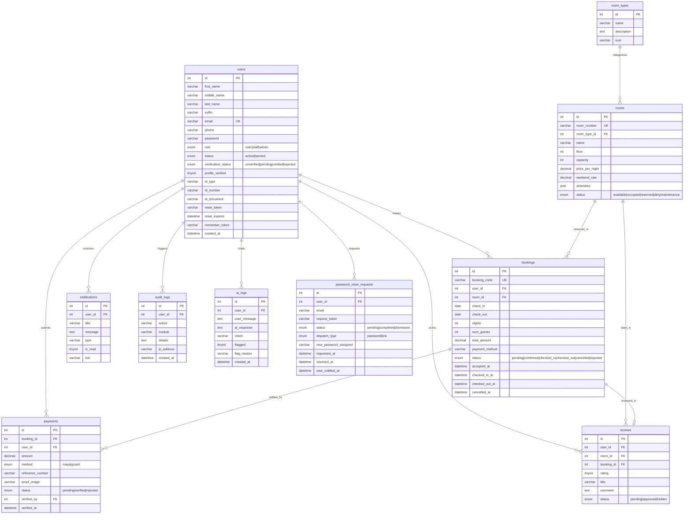

# Marvelous Hotel — Entity-Relationship Diagram (ERD) & Data Dictionary

Database Engine: **MySQL / MariaDB (InnoDB, `utf8mb4_unicode_ci`)**  
Database Name: `marvelous_hotel`  
Access Layer: **PHP PDO Prepared Statements** (`backend/core/db.php`)

---

## 1. Entity-Relationship Diagram

---

## 2. Complete 14-Table Data Dictionary

| # | Table | Purpose | Key Constraints |
| :--- | :--- | :--- | :--- |
| 1 | `users` | Guest, Staff, and Super Admin accounts, KYC identity verification, email/reset/remember tokens | `UNIQUE(email)`, normalized full-name index |
| 2 | `room_types` | Accommodation categories (Standard, Deluxe, Suite, Family, Dormitory, Studio) | `PRIMARY KEY(id)` |
| 3 | `rooms` | Physical room & dormitory bed inventory, pricing, amenities, housekeeping status | `UNIQUE(room_number)`, `FK(room_type_id)` |
| 4 | `bookings` | Room reservations, date windows `[check_in, check_out)`, lifecycle timestamps | `UNIQUE(booking_code)`, `FK(user_id)`, `FK(room_id)` |
| 5 | `payments` | Maya & GCash payment submissions, reference numbers, receipt proofs, verification timestamps | `FK(booking_id)`, `FK(user_id)` |
| 6 | `reviews` | Verified stay ratings and general hotel guest feedback | `FK(user_id)`, nullable `FK(room_id)` & `FK(booking_id)` |
| 7 | `notifications` | In-app alerts for booking updates, payment verification, KYC decisions, and admin alerts | `FK(user_id)` |
| 8 | `audit_logs` | Immutable security & operational audit trail (actor, module, action, IP, timestamp) | Indexed on `created_at` & `user_id` |
| 9 | `ai_logs` | Marvi AI conversation logs, intent classification, and flagged security threat records | Indexed on `flagged` & `created_at` |
| 10 | `settings` | Dynamic key-value hotel configuration (Maya/GCash details, Gmail SMTP, NVIDIA NIM AI config) | `UNIQUE(key)` |
| 11 | `contact_messages` | Public contact form guest inquiries | `PRIMARY KEY(id)` |
| 12 | `rate_limits` | Sliding-window brute-force and AI quota throttle records | Indexed on `(key, created_at)` |
| 13 | `password_reset_requests` | Live Admin-assisted password reset queue with SHA-256 session token & one-time view tracking | `FK(user_id)`, indexed on `status` & `request_token` |
| 14 | `schema_migrations` | Versioned SQL migration ledger maintained by `database/migrate.php` | `PRIMARY KEY(migration)` |
