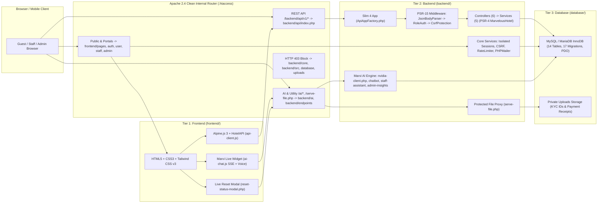
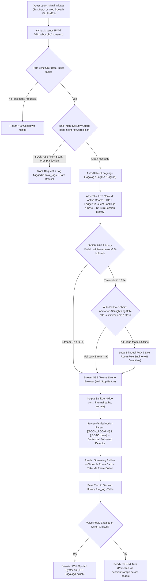
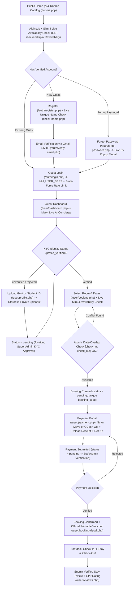
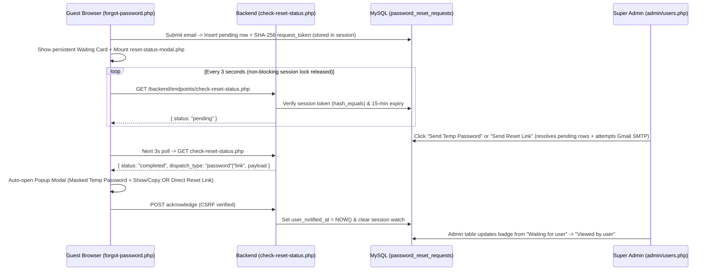
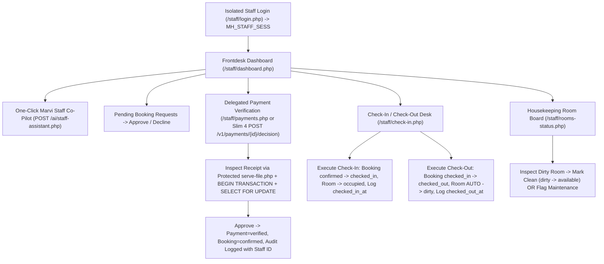
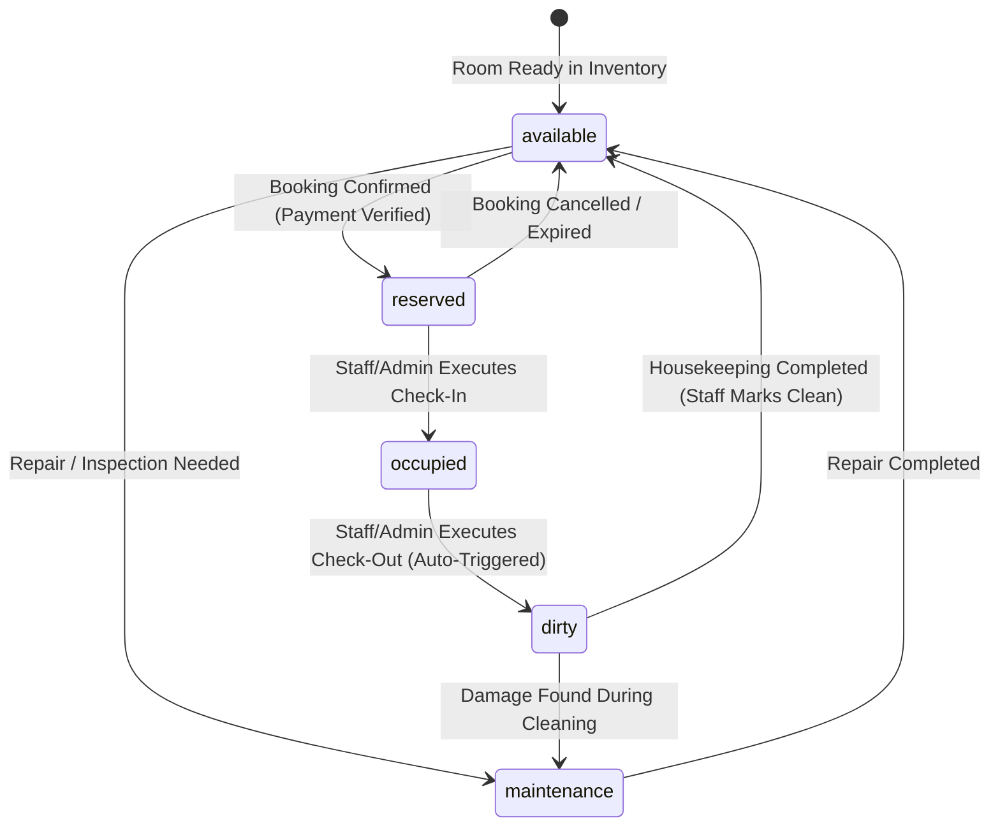
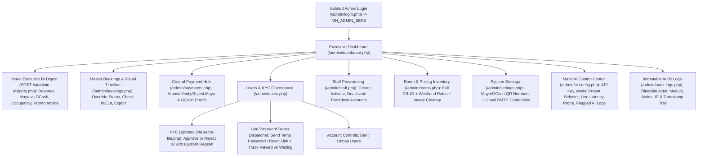
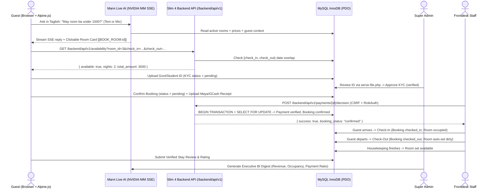

# Marvelous Hotel & Dormitory — Complete System Flows & Tech Stack (Capstone Defense Master Guide)

> **Edition:** November 20, 2026 (Framework-Powered 3-Tier Architecture — Defense Ready)  
> **Project:** Marvelous Hotel & Dormitory Booking and Reservation Management System with Marvi Live AI  
> **Architecture:** Clean 3-Tier Separation (`frontend/` ↔ `backend/` ↔ `database/`)  
> **Automated QA Status:** PHPUnit 10 — **32/32 Tests Passed (185 Assertions)**, 0 Lint Errors  

---

## 1. Kumpletong Tech Stack: Languages, Frameworks & Architecture

Ito ang opisyal na breakdown ng lahat ng **Languages**, **Frameworks**, **Libraries**, at **Tools** na ginamit sa bawat tier ng proyekto—handa para sa *Methodology / System Architecture* slide at *Panel Q&A*.

| Tier / Layer | Root Folder | Languages Used | Frameworks & Core Libraries | Purpose & Defense Justification (*Bakit Ito Pinili?*) |
| :--- | :--- | :--- | :--- | :--- |
| **Tier 1: Frontend (Presentation Layer)** | `frontend/` | **HTML5**, **CSS3**, **JavaScript (ES6+)** | **Tailwind CSS v3.4** (`preflight: false`, custom Navy/Gold theme), **Alpine.js v3.14** (offline local bundle), **Font Awesome 6**, **`HotelAPI`** (`fetch` REST client), **Web Speech API** (Mic STT & TTS) | Malinis at responsive na UI nang walang mabigat na SPA overhead; reactive live room availability widgets, token-by-token SSE AI chat streaming, Voice Mode, at live password reset popup. |
| **Tier 2: Backend (Application & REST API)** | `backend/` | **PHP 8** (JSON & Server-Sent Events / SSE) | **Slim 4 Framework** (`slim/slim 4.15`, `slim/psr7`, `FastRoute`), **PSR-4 Autoloading** (`MarvelousHotel\`), **PSR-15 Middleware** (`JsonBodyParser`, `RoleAuth`, `CsrfProtection`), **Composer**, **PHPMailer 7** (Gmail SMTP) | Standard REST API (`/backend/api/v1/*`), malinis na Controller → Service separation, 3-actor isolated sessions, CSRF & RBAC middleware protection, at automated Gmail SMTP notifications. |
| **AI Intelligence Engine** | `backend/ai/` | **PHP 8**, **JSON**, **SSE Stream** | **NVIDIA NIM API** — Primary: `nvidia/nemotron-3.5-bolt-e4b` (~0.8s latency), Auto-Failover: `nemotron-3.5-lightning-30b-a3b` & `minimax-m3.1-flash`, Local Bilingual Rule Engine | Real-time streaming bilingual concierge (Tagalog/English/Taglish), multi-turn memory, interactive Room Cards & navigation buttons, plus Staff Shift Co-Pilot, Admin Executive BI, at 0% downtime offline fallback. |
| **Tier 3: Database (Data Persistence)** | `database/` | **SQL** | **MySQL / MariaDB** (**InnoDB**, `utf8mb4_unicode_ci`), **PHP PDO** (Prepared Statements & Row Locking `SELECT ... FOR UPDATE`), **14 Normalized Tables**, **17 Versioned SQL Migrations** (`database/migrate.php`) | ACID-compliant booking & payment transactions, 100% SQL injection prevention via prepared statements, date-overlap double-booking protection, at reproducible schema migration history. |
| **Routing, Security, QA & Deployment** | `tests/`, `scripts/`, `.htaccess` | **PHP 8**, **Bash**, **Apache Conf** | **PHPUnit 10** (32 tests / 185 assertions), **Apache 2.4** (`mod_rewrite` / `.htaccess`), **XAMPP / Docker**, **Cloudflare & Ngrok Tunnel** (`share-capstone.sh`) | Clean URLs habang naka-HTTP 403 block ang internal folders (`backend/core/`, `backend/src/`, `database/`, `uploads/`), automated regression testing, at instant live mobile demo sa defense. |

---

## 2. Overall 3-Tier Clean Architecture & Request Routing Flow

Zero loose `.php` files ang nasa root directory. Ang root `.htaccess` ang nagsisilbing malinis na internal router na nagre-route ng public, portal, API, at AI requests papunta sa tamang tier habang hinaharang ang direct access sa sensitive internal files.

### Isolated 3-Actor Session Design
Upang maiwasan ang session overwrite o privilege bleed kapag sabay-sabay na naka-login ang Guest, Staff, at Admin sa iisang browser (napakahalaga sa live capstone demo!):
- **Guest / Public:** `MH_USER_SESS` cookie
- **Frontdesk Staff:** `MH_STAFF_SESS` cookie
- **Super Admin:** `MH_ADMIN_SESS` cookie
- **Shared Slim 4 API (`/backend/api/v1/*`):** Gumagamit ng `X-Portal` header / `Referer` detection para laging tamang session cookie ang i-load sa bawat API call.

---

## 3. Complete AI Flow (Marvi Live AI — Tri-Role Architecture)

Ang **Marvi AI** ay hindi simpleng static FAQ chatbot. Isa itong **Tri-Role Real-Time AI Ecosystem** na may **Server-Sent Events (SSE) token-by-token streaming**, **Voice Mode (Mic + TTS)**, **multi-turn memory**, **live database awareness**, **security guardrails**, at **automatic model failover**.

### 3.1 Guest Concierge Real-Time Streaming & Voice Pipeline (`POST /ai/chatbot.php?stream=1`)

### 3.2 Tri-Role AI Modules Overview

| AI Module | Endpoint / File | Target Actor | Live Database Context Injected | Output Delivered |
| :--- | :--- | :--- | :--- | :--- |
| **Marvi Live Concierge** | `backend/ai/chatbot.php` + `nvidia-client.php` | Public & Guest (all 10+ guest pages) | Live room catalog with IDs/prices, guest's own booking status & KYC status, 12-turn memory | Token-by-token SSE reply, clickable **Room Cards** (`[[BOOK_ROOM:id]]`), **Take Me There →** buttons (`[[GOTO:route]]`), Voice Mic & TTS |
| **Smart Room Matcher** | `frontend/user/ai-recommend.php` | Guest | Budget range, guest count, room type preference, live room inventory & ratings | Ranked Top Room / Dormitory Matches with match score and direct 1-click Book button |
| **Staff Shift Co-Pilot** | `backend/ai/staff-assistant.php` | Frontdesk Staff | Today's check-ins, check-outs, pending bookings/payments, `dirty` & `maintenance` rooms | Actionable shift briefing & prioritized frontdesk checklist |
| **Admin Executive BI** | `backend/ai/admin-insights.php` | Super Admin | Total & monthly verified revenue, Maya vs GCash ratio, occupancy %, KYC backlog, flagged AI threats | Executive business insights, pricing/promo recommendations, security summary |

---

## 4. Complete User / Guest Flow (`MH_USER_SESS`)

Saklaw nito ang kumpletong paglalakbay ng bisita—mula pag-browse, real-time room availability check, account registration, live password reset popup, KYC ID verification, booking, Maya/GCash payment, hanggang post-stay review.

### 4.1 Real-Time Password Reset Popup Flow (Zero-Email-Delay Support)

Kung makalimutan ng bisita ang password (at kahit hindi agad mabuksan ang inbox o offline ang Gmail SMTP), may **Live Session-Bound Password Reset Popup** ang system:

---

## 5. Complete Staff (Frontdesk) Flow (`MH_STAFF_SESS`)

Ang **Frontdesk Staff Portal** ay sumusunod sa **Principle of Least Privilege**—nakatutok sa mabilis na check-in/check-out, delegated Maya/GCash verification, at automated housekeeping monitoring. Walang access ang staff sa user password reset, staff creation, system settings, o audit log deletion.

### 5.1 Automated Room & Housekeeping State Machine

---

## 6. Complete Super Admin Flow (`MH_ADMIN_SESS`)

Ang **Super Admin Portal** ang executive command center na may buong governance sa pananalapi, KYC adjudication, live password resets, staff provisioning, room inventory, Gmail SMTP, Marvi AI configuration, at immutable security audit logs.

---

## 7. Role-Based Access Control (RBAC) Matrix

| Feature / Capability | Public / Guest (`MH_USER_SESS`) | Frontdesk Staff (`MH_STAFF_SESS`) | Super Admin (`MH_ADMIN_SESS`) | Marvi AI Engine (`backend/ai/`) |
| :--- | :---: | :---: | :---: | :---: |
| Browse Rooms & Live Slim 4 Availability | ✅ Yes | ✅ Yes | ✅ Yes | ✅ Reads Live Catalog |
| Marvi Live SSE Chat & Voice Mode | ✅ Yes (All Guest Pages) | ❌ Uses Shift Co-Pilot | ❌ Uses Executive BI | ✅ Powers All 3 Roles |
| Upload KYC Valid ID (Govt / Student ID) | ✅ Yes (`profile.php`) | ❌ No | ❌ No | ❌ No |
| Approve / Reject KYC Identity Documents | ❌ Blocked | ❌ Blocked | ✅ Master Control | ❌ No |
| Create Room Booking (Requires Verified KYC) | ✅ Yes (`booking.php`) | ❌ No | ✅ Override Only | ✅ Recommends & Links |
| Cancel Own Pending Booking (`POST /v1/bookings/{id}/cancel`) | ✅ Yes (CSRF Protected) | ❌ No | ✅ Master Control | ❌ No |
| Upload Maya / GCash Payment Receipt | ✅ Yes (`payment.php`) | ❌ No | ❌ No | ✅ Guides Process |
| Atomic Payment Verification (`FOR UPDATE`) | ❌ Blocked | ✅ Delegated Approval | ✅ Master Approval | ❌ No |
| Execute Guest Check-In & Check-Out | ❌ Blocked | ✅ Daily Operations | ✅ Master Override | ❌ No |
| Toggle Room Housekeeping (`dirty` → `available`) | ❌ Blocked | ✅ Yes | ✅ Yes | ✅ Monitors Dirty Rooms |
| Live Password Reset Dispatch & Tracking | 📥 Receives Popup Only | ❌ Blocked | ✅ Master Dispatcher | ❌ No |
| Create / Manage Staff Accounts | ❌ Blocked | ❌ Blocked | ✅ Exclusive | ❌ No |
| Room Inventory & Pricing CRUD | ❌ Blocked | ❌ Blocked | ✅ Exclusive | ❌ No |
| Gmail SMTP & Marvi AI Config / Probe | ❌ Blocked | ❌ Blocked | ✅ Exclusive | ❌ Read-Only Config |
| Security Audit Trail (`audit_logs`) | ❌ Blocked | ❌ Blocked | 🔒 View-Only (Immutable) | 📝 Logs AI Prompts |

---

## 8. End-to-End Cross-Actor Collaboration Sequence

Ipinapakita nito kung paano nagtutulungan ang **Guest**, **Marvi AI**, **Slim 4 API**, **MySQL Database**, **Frontdesk Staff**, at **Super Admin** sa iisang kumpletong reservation lifecycle:

---

## 9. Slim 4 REST API v1 & Database Quick Reference

### 9.1 Slim 4 REST API Endpoints (`backend/src/ApiAppFactory.php`)

| Method | Endpoint | Auth / Middleware | Controller → Service | Purpose |
| :--- | :--- | :--- | :--- | :--- |
| `GET` | `/backend/api/v1/health` | Public | `HealthController` | API health, version, and runtime status |
| `GET` | `/backend/api/v1/rooms` | Public | `RoomController` → `RoomService` | Filterable active room catalog |
| `GET` | `/backend/api/v1/rooms/{id}` | Public | `RoomController` → `RoomService` | Single room details & amenities |
| `GET` | `/backend/api/v1/availability` | Public | `RoomController` → `RoomService` | Real-time date-range availability & dynamic pricing |
| `GET` | `/backend/api/v1/auth/status` | Portal-Aware | `AuthController` → `AuthService` | Active session role, user summary & CSRF token |
| `GET` | `/backend/api/v1/bookings` | `RoleAuth(user,staff,admin)` | `BookingController` → `BookingService` | Role-scoped booking list |
| `POST` | `/backend/api/v1/bookings/{id}/cancel` | `RoleAuth(user)` + `CsrfProtection` | `BookingController` → `BookingService` | Guest self-cancellation of pending bookings |
| `GET` | `/backend/api/v1/payments` | `RoleAuth(user,staff,admin)` | `PaymentController` → `PaymentService` | Role-scoped payment records |
| `POST` | `/backend/api/v1/payments/{id}/decision` | `RoleAuth(staff,admin)` + `CsrfProtection` | `PaymentController` → `PaymentService` | Atomic payment verification / rejection (`FOR UPDATE`) |
| `GET` | `/backend/api/v1/dashboard/metrics` | `RoleAuth(user,staff,admin)` | `DashboardController` → `DashboardService` | Live KPI metrics per active actor role |

### 9.2 Database Summary (`database/ERD.md`)
- **Engine:** MySQL / MariaDB InnoDB (`utf8mb4_unicode_ci`)
- **14 Normalized Tables:** `users`, `room_types`, `rooms`, `bookings`, `payments`, `reviews`, `notifications`, `audit_logs`, `ai_logs`, `settings`, `contact_messages`, `rate_limits`, `password_reset_requests`, `schema_migrations`
- **17 Versioned Migrations:** `database/migrations/0001_*.sql` through `0017_update_nvidia_ai_model.sql`, managed via `php database/migrate.php`

---

## 10. Capstone Defense Panel Q&A Cheat Sheet (12 High-Impact Questions)

1. **Q: Ano ang architecture at mga frameworks na ginamit ninyo sa project?**  
   **A:** Gumamit po kami ng **Framework-Powered 3-Tier Architecture** na malinis na nakahiwalay sa `frontend/`, `backend/`, at `database/`. Sa **Frontend**, **HTML5, CSS3, ES6+ JavaScript** kasama ang **Tailwind CSS v3** at **Alpine.js 3**. Sa **Backend**, **PHP 8** gamit ang **Slim 4 Framework** (PSR-4 Controllers/Services at PSR-15 Middleware) at **PHPMailer 7**. Sa **Database**, **MySQL/MariaDB SQL** gamit ang **PDO Prepared Statements** at 17 versioned migrations.

2. **Q: Bakit Slim 4 + Tailwind + Alpine.js ang pinili ninyo imbes na Laravel o React?**  
   **A:** Dahil ang target deployment ng local hotel/dormitory ay lightweight at madaling i-host sa standard Apache/XAMPP o Docker nang walang mabigat na Node build server sa runtime. Binibigyan kami ng **Slim 4** ng modern PSR-4/PSR-15 REST API architecture nang napakabilis, habang ang **Tailwind CSS + Alpine.js** ay nagbibigay ng reactive real-time UI (live availability checks, SSE AI streaming, modals) na mabilis mag-load kahit sa mobile data.

3. **Q: Paano ninyo sinisigurado na hindi nagkakaroon ng double-booking o race condition sa bayad?**  
   **A:** Dalawang layer po ang proteksyon namin: Una, ang real-time date-overlap algorithm `[check_in, check_out)` sa `RoomService` at `booking.php`. Pangalawa, ang **ACID database transactions (`BEGIN TRANSACTION` + `SELECT ... FOR UPDATE`)** sa MySQL InnoDB upang i-lock ang booking/payment row habang nagve-verify ang Staff o Admin—siguradong walang dalawang actor ang makakapag-overwrite nang sabay.

4. **Q: Paano gumagana ang Marvi AI? Live LLM ba talaga o hardcoded lang?**  
   **A:** **Hybrid Real-Time Live LLM** po. Nakakonekta ito sa **NVIDIA NIM API** gamit ang `nvidia/nemotron-3.5-bolt-e4b` na may **Server-Sent Events (SSE) token-by-token streaming** (~0.8s response time), multi-turn conversation memory, at optional **Voice Mode (Web Speech Mic + TTS)**. May auto-failover ito sa backup cloud models at local bilingual rule engine kapag nawalan ng internet—kaya **0% downtime** sa defense o production.

5. **Q: Paano ninyo pinoprotektahan ang Marvi AI laban sa prompt injection o hacking queries?**  
   **A:** May tatlong guardrail layers po kami: (1) Rate limiting sa `rate_limits` table, (2) Bad-Intent Security Filter (`bad-intent-keywords.json`) na humaharang sa SQLi/XSS/port-scan/prompt-injection at nagla-log ng `flagged = 1` sa `ai_logs`, at (3) Output Sanitizer na nagtatago ng internal file paths, port numbers, at credentials.

6. **Q: Paano nakakatulong ang AI sa Staff at Admin, hindi lang sa Guest?**  
   **A:** Tri-role po ang Marvi AI: (1) **Guest Concierge & Smart Room Matcher** para sa booking guidance at clickable room cards; (2) **Staff Shift Co-Pilot** (`staff-assistant.php`) na bumubuo ng daily arrivals, departures, at dirty-rooms briefing; at (3) **Admin Executive BI** (`admin-insights.php`) na nagsusuri ng revenue, Maya vs GCash ratio, occupancy rate, at promo strategy.

7. **Q: Paano ninyo pinoprotektahan ang uploaded Government/Student IDs at GCash/Maya receipts?**  
   **A:** Naka-HTTP 403 block ang `uploads/` directory via `.htaccess` kaya hindi mabubuksan kahit alam ang URL. Lahat ng sensitive images ay dumadaan lamang sa **`backend/endpoints/serve-file.php`**, na nagbe-verify muna ng active session role at ownership (sariling file ng guest, o Admin/Staff role) bago i-stream ang image.

8. **Q: Bakit magkahiwalay ang session cookies ng Guest, Staff, at Admin?**  
   **A:** Gumagamit kami ng **Isolated Session Namespaces** (`MH_USER_SESS`, `MH_STAFF_SESS`, `MH_ADMIN_SESS`) upang maiwasan ang session fixation at privilege bleed, at upang ma-demo nang sabay-sabay sa iisang browser ang Guest, Staff, at Admin portals nang hindi nagla-logout ang isa't isa.

9. **Q: Ano ang ginagawa ng Live Password Reset Popup kung nakalimutan ng user ang password?**  
   **A:** Kapag nag-request ang user sa `forgot-password.php`, gumagawa ang system ng SHA-256 session-bound watch token. Nagpo-poll ang `reset-status-modal.php` kada 3 segundo (nang naka-release ang PHP session lock para walang lag). Pag-click ng Admin ng *Send Temp Password* o *Send Reset Link*, lalabas agad ang 1-time masked popup sa screen ng user (15-min expiry) at mag-a-update sa Admin screen mula *Waiting for user* patungong *Viewed by user*—kahit walang internet o delay ang email!

10. **Q: Bakit kailangan pa ng Frontdesk Staff portal kung may Super Admin naman?**  
    **A:** Para sa **Separation of Duties at Principle of Least Privilege**. Ang Staff ay para sa araw-araw na desk operations (check-in, check-out, housekeeping status, delegated payment verification) nang walang kakayahang mag-delete ng audit logs, mag-reset ng password, o magbago ng room pricing/system settings.

11. **Q: Ano ang nangyayari sa kwarto pagkatapos mag-check-out ang guest?**  
    **A:** May **Automated Housekeeping State Machine** kami: pag-click ng Staff ng Check-Out, awtomatikong lumilipat ang booking sa `checked_out` at ang room status sa `dirty`. Hindi ito agad maibebenta sa susunod na walk-in hangga't hindi minamarkahan ng Staff sa `rooms-status.php` na malinis na (`available`).

12. **Q: Paano ninyo napatunayan na gumagana at reliable ang codebase bago ang defense?**  
    **A:** Gumagamit kami ng **PHPUnit 10 Automated Test Suite** (`tests/`) na may **32 passing unit & integration tests (185 assertions)** na sumusubok sa Slim 4 routes, PSR-15 RoleAuth at CSRF middleware, Room availability math, at Booking/Payment services, plus zero PHP/JS lint errors at 100% applied SQL migrations (`0001`–`0017`).
